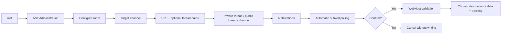
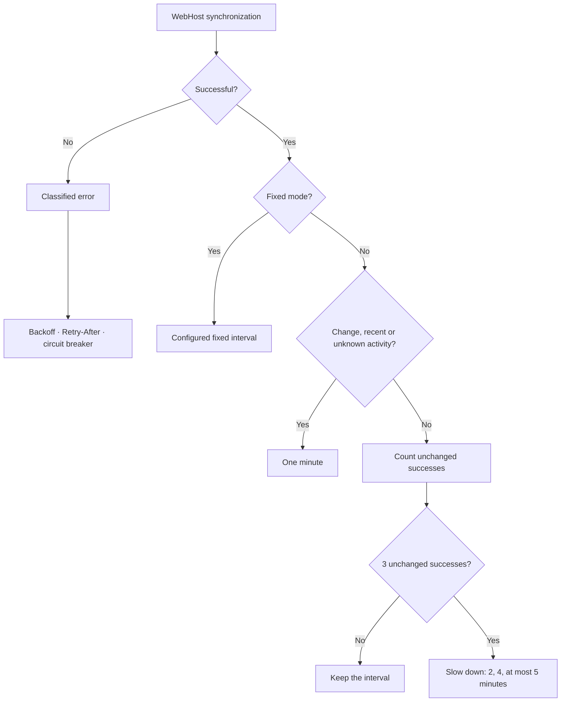
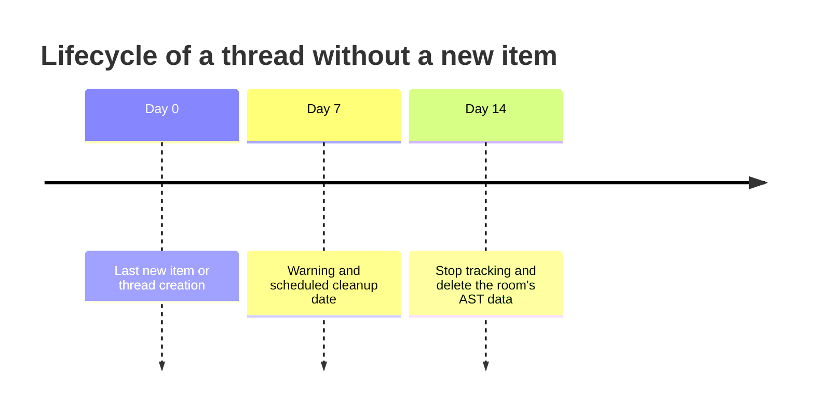
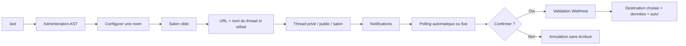
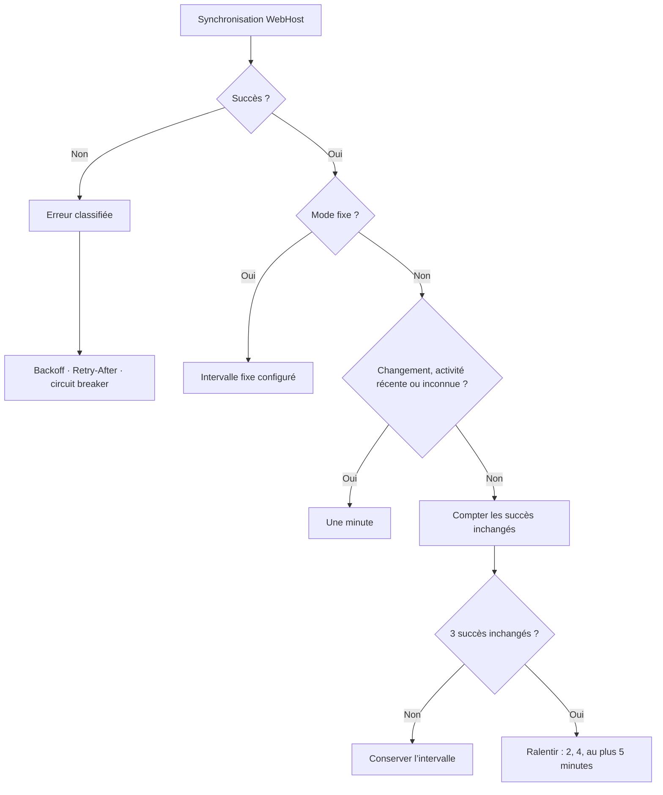
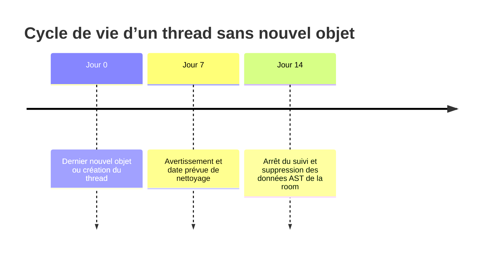

# Room tracking

[English](#english) · [Français](#français)

## English

### Configuring a room

From a text channel, open `/ast`, then **AST Administration → Configure room**. The wizard asks for:

1. the text channel that will host tracking or the new thread;
2. the exact WebHost URL and a thread name when using a thread;
3. a private thread (default), public thread, or the channel directly without creating a thread;
4. normal or silent notifications;
5. automatic polling (default) or a fixed frequency;
6. final confirmation.

The URL must use the exact `http(s)://host/room/<id>` form, without HTTP credentials, a query string, or a fragment. The wizard summary displays only the validated host and never the full private identifier.

In channel mode, all room notifications and files are posted directly in the selected text channel. Only one room may be tracked per destination; a configured channel is never silently replaced. The existing rule preventing the same Archipelago room from being tracked twice on one server still applies. A parent channel may host a direct room and separate tracked threads for other rooms.

`/ast`, personal commands, recaps and portals recognize the tracked text channel as a room. Members with access can use personal/read actions. Guild managers or users with **Manage Channels** on that channel can manage its tracking; **Manage Threads** alone does not grant management of a direct channel room. Creating a new tracking setup still requires an AST-recognized guild manager.

Stopping tracking removes AST's room data and local files, preserving the Discord channel and messages. The existing seven/fourteen-day inactivity policy remains specific to threads; it is not applied to direct channels. Public/private thread behavior is preserved. No privileged intents are required.

### Frequencies and adaptive polling

Automatic polling is the default for the wizard, `/add-url`, and the Web portal. A frequency is requested only for fixed mode; its choices are `5m`, `15m`, `30m`, `1h`, `6h`, `12h`, `18h`, and `1d`, with `5m` as the default.

Automatic mode is used by default:

- the base interval is **one minute**, including for older automatic rooms with a longer stored frequency;
- activity or a connection within the last 15 minutes keeps that interval, even when the response content is unchanged;
- missing or unreadable activity information also keeps the one-minute interval;
- only known inactivity combined with unchanged responses allows slowdown: every three unchanged successes can advance the interval to two, four, then at most **five minutes**;
- a content change or recent activity returns to one minute. Older automatic ceilings above five minutes no longer increase this limit.

From **Manage room → Polling**, managers can select:

- automatic mode, using the activity-aware policy above;
- fixed mode at `5m`, `15m`, `30m`, `1h`, `6h`, `12h`, `18h`, or `1d`.

`/add-url polling-mode:automatic` does not use `Frequency Check` as a minimum. `/update-frequency-check` changes the stored fixed-mode frequency without switching modes. The information views display the automatic policy or fixed interval accordingly. Big Async mode retains its fixed one-hour behavior.

A positive jitter adds at most five seconds. Intervals start after processing finishes, so HTTP, database work, Discord delivery and queueing add to the observed delay. Pauses, error backoff and `Retry-After` can delay a poll beyond the normal five-minute automatic ceiling. The scheduler also limits concurrent requests globally and per WebHost origin.

Concurrent reads of the same WebHost endpoint are shared, while persistence and notifications remain separate for each room. AST still reads public HTTP APIs: it is not a real-time Archipelago protocol client. A newly received item can therefore wait for upstream WebHost data and AST's next poll.

### Tracking health and controls

The room view includes the running/paused state, configured and effective interval, last successful synchronization, last detected activity, next due time, consecutive failures, error type, and latency.

Managers can use:

- **Synchronize now**: immediate priority with a persistent 30-second cooldown;
- **Pause**: prevents future polls without cancelling one already in progress;
- **Resume**: re-enables and reschedules the room;
- **Polling**: changes the mode and interval;
- **Notifications**: switches between normal and silent behavior.

After each synchronization, the console reports the guild, thread, status, duration, and next run. Statuses distinguish no new item, new items, new hints, updated hints, completed goals, removed tracking, 404, rate limiting, server error, timeout, network error, HTML/invalid content, invalid JSON, partial response, and an open circuit.

### Shared slots and mentions

Several users can associate the same slot. For every new item, AST computes recipients separately from the slot association, item-type mention filter, and personal exclusions. Every remaining user is mentioned, while recap histories remain separate for each user.

**Silent** mode suppresses general announcements when no user is associated. Explicitly associated users continue receiving relevant notifications according to their preferences.

### Inactivity: 7 then 14 days

The timer is based on the last **newly received item**, or on the thread creation time if no item has ever been recorded.

At 14 days, AST removes the URL/configuration, items, hints, aliases, recaps, exclusions, polling state, portal tokens, and local room files. This routine does not delete the Discord thread itself. A new item before the deadline resets the timer.

### Legacy scheduler

`USE_LEGACY_TRACKING_SCHEDULER=true` temporarily restores the former scan loop. Pause/resume/forced synchronization controls and adaptive polling are unavailable in this mode. Use it only as a diagnostic rollback.

---

## Français

### Configurer une room

Depuis un salon texte, ouvrez `/ast` puis **Administration AST → Configurer une room**. L’assistant demande :

1. le salon texte qui accueillera le suivi ou le nouveau thread ;
2. l’URL WebHost exacte et un nom de thread si un thread est utilisé ;
3. un thread privé (par défaut), un thread public ou le salon directement, sans création de thread ;
4. des notifications normales ou silencieuses ;
5. le polling automatique (par défaut) ou une fréquence fixe ;
6. une confirmation finale.

L’URL doit avoir la forme exacte `http(s)://hôte/room/<id>`, sans identifiants HTTP, query string ni fragment. Le récapitulatif de l’assistant ne montre que l’hôte, jamais l’identifiant privé complet.

En mode salon, les notifications et fichiers de la room sont publiés directement dans le salon texte choisi. Une seule room peut être suivie par destination ; un suivi existant n'est jamais remplacé silencieusement. La règle empêchant le suivi de la même room Archipelago deux fois sur un serveur reste applicable. Un salon parent peut accueillir un suivi direct et des threads de suivi pour d'autres rooms.

`/ast`, les commandes personnelles, les récapitulatifs et les portails reconnaissent le salon suivi comme une room. Les membres ayant accès au salon peuvent utiliser les actions personnelles et de consultation. La gestion du suivi est réservée aux gestionnaires de serveur reconnus par AST ou aux membres ayant **Gérer les salons** sur ce salon ; **Gérer les fils** seul ne suffit pas en mode salon. La création d'un nouveau suivi reste réservée aux gestionnaires reconnus par AST.

L'arrêt du suivi supprime les données AST et les fichiers locaux de la room, en conservant le salon Discord et ses messages. La règle d'inactivité de sept/quatorze jours reste propre aux threads ; elle n'est pas appliquée aux salons suivis directement. Les modes thread public et privé sont conservés. Aucun intent privilégié n'est requis.

### Fréquences et polling adaptatif

Le polling automatique est le choix par défaut de l’assistant, de `/add-url` et du portail. La fréquence n’est demandée qu’en mode fixe : `5m`, `15m`, `30m`, `1h`, `6h`, `12h`, `18h`, `1d`, avec `5m` par défaut.

Par défaut, le mode est automatique :

- la cadence de base est **une minute**, y compris pour les anciennes rooms automatiques ayant une fréquence enregistrée plus longue ;
- une activité ou une connexion dans les quinze dernières minutes conserve cette cadence, même si le contenu de la réponse est identique ;
- des informations d’activité absentes ou illisibles conservent également la minute ;
- seule une inactivité connue avec des réponses identiques autorise le ralentissement : chaque série de trois succès inchangés peut porter l’intervalle à deux, quatre, puis **cinq minutes maximum** ;
- un changement de contenu ou une activité récente rétablit la minute. Les anciens plafonds automatiques supérieurs à cinq minutes n’augmentent plus cette limite.

Dans **Gérer la room → Polling**, les gestionnaires peuvent sélectionner :

- automatique, selon la politique d’activité ci-dessus ;
- fixe à `5m`, `15m`, `30m`, `1h`, `6h`, `12h`, `18h` ou `1d`.

`/add-url polling-mode:automatic` n’utilise pas `Frequency Check` comme minimum. `/update-frequency-check` modifie la fréquence mémorisée du mode fixe sans changer de mode. Les vues d’information affichent la politique automatique ou l’intervalle fixe selon le cas. Le mode Big Async conserve son suivi fixe à une heure.

Un jitter positif ajoute au plus cinq secondes. Les intervalles commencent après la fin du traitement : HTTP, base de données, envoi Discord et file d’attente s’ajoutent au délai observé. Les pauses, backoffs d’erreur et `Retry-After` peuvent dépasser le plafond automatique normal de cinq minutes. Le scheduler limite également les requêtes simultanées globalement et par origine WebHost.

Les lectures simultanées du même endpoint WebHost sont mutualisées ; persistance et notifications restent propres à chaque room. AST lit toujours les API HTTP publiques, sans connexion au protocole de jeu Archipelago. Un objet nouvellement reçu peut donc attendre la mise à jour des données WebHost et le prochain poll AST.

### Santé et commandes de suivi

La vue de room affiche notamment : état en cours/pause, intervalle configuré et effectif, dernière synchronisation réussie, dernière activité, prochaine échéance, erreurs consécutives, type d’erreur et latence.

Les gestionnaires disposent de :

- **Synchroniser maintenant** : priorité immédiate avec cooldown persistant de 30 secondes ;
- **Pause** : arrête les prochains polls sans annuler celui déjà en cours ;
- **Reprendre** : réactive et reprogramme la room ;
- **Polling** : change le mode et l’intervalle ;
- **Notifications** : normal ou silencieux.

Après chaque synchronisation, la console indique le serveur, le thread, le statut, la durée et le prochain passage. Le statut distingue : aucun nouvel objet, nouveaux objets, nouveaux hints, hints mis à jour, objectifs terminés, suivi supprimé, 404, rate limit, erreur serveur, timeout, réseau, contenu HTML/invalide, JSON invalide, réponse partielle ou circuit ouvert.

### Slots partagés et mentions

Plusieurs utilisateurs peuvent associer le même slot. Pour chaque nouvel objet, AST calcule les destinataires individuellement : association au slot, filtre de type d’objet et exclusions personnelles. Tous les utilisateurs restants sont mentionnés ; les récaps restent séparés par utilisateur.

Le mode **silencieux** supprime les annonces générales sans association. Les utilisateurs explicitement associés continuent de recevoir les notifications qui les concernent selon leurs préférences.

### Inactivité : 7 puis 14 jours

Le délai est basé sur le dernier **nouvel objet reçu**, ou sur la date de création du thread si aucun objet n’a encore été enregistré.

À 14 jours, AST supprime l’URL/configuration, les objets, hints, alias, récaps, exclusions, état de polling, tokens de portail et fichiers locaux de la room. Le thread Discord lui-même n’est pas supprimé par cette routine. Un nouvel objet avant l’échéance réinitialise le délai.

### Scheduler historique

`USE_LEGACY_TRACKING_SCHEDULER=true` réactive temporairement l’ancien scan. Dans ce mode, les contrôles pause/reprise/synchronisation forcée et le polling adaptatif ne sont pas disponibles. Utilisez-le uniquement comme rollback de diagnostic.
